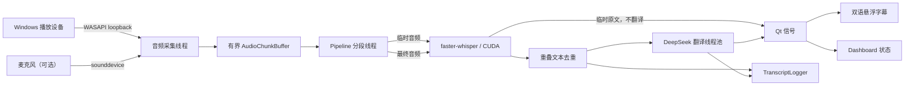
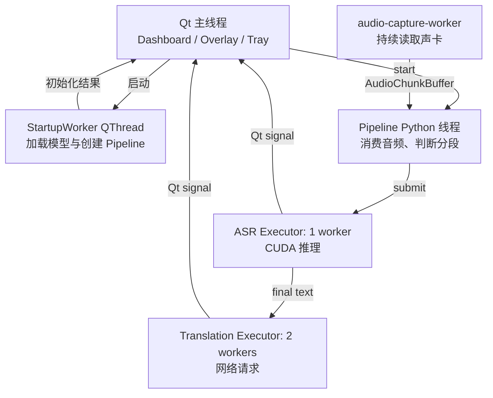

# 实时字幕翻译工具：技术实现说明

> 文档状态：基于 2026-07-22 的当前代码整理  
> 适用平台：当前主要运行环境为 Windows 11  
> 当前主路径：Windows 系统音频 -> faster-whisper（CUDA）-> DeepSeek -> 双语悬浮字幕

## 1. 这份文档解决什么问题

这份文档记录项目**现在已经实现的技术方案**，以及各模块为什么这样设计。它主要回答以下问题：

1. 程序从哪里启动，启动后发生了什么？
2. 视频声音怎样变成英文文字，再变成中文字幕？
3. 为什么需要多个线程，它们分别负责什么？
4. 配置文件中的参数会影响什么？
5. 字幕漏句、延迟、没有译文时，应从哪里排查？
6. 当前实现还有哪些已知限制，后续应该怎样继续改进？

本文是对当前实现的动态说明；最初的仓库结构快照仍保留在 `ARCHITECTURE.md`。如果以后功能发生变化，应同步更新本文，而不是把本文当成永远不变的设计。

## 2. 一句话理解整个程序

程序持续截取电脑正在播放的声音，把短音频放进有容量上限的缓冲区；后台线程判断一句话何时结束，将稳定音频交给 GPU 上的 Whisper 识别，再把最终英文交给 DeepSeek 翻译，最后通过 Qt 信号把原文和译文送到悬浮字幕窗口，并同时写入日志。

## 3. 系统全景



这里最重要的区别是：

| 字幕类型 | 用途 | 是否翻译 | 是否写入正式日志 |
|---|---|---:|---:|
| 临时字幕（partial） | 尽快显示正在说的内容，结果仍可能变化 | 否 | 否 |
| 最终字幕（final） | 一段语音结束后的稳定结果 | 是 | 是 |

如果把每一次临时识别都发给翻译 API，不仅费用和请求量会增加，译文还会不停改写。因此当前方案只翻译最终字幕。

## 4. 模块与职责

项目遵循“音频、识别、翻译、稳定、界面、存储彼此分开”的原则。

| 文件 | 主要职责 | 不负责什么 |
|---|---|---|
| `dashboard.py` | 主控制界面、设置页面、系统托盘、启动和停止流程 | 不直接做音频识别或网络翻译 |
| `main.py` | 组装各模块，管理实时处理流水线和后台任务 | 不实现具体的声卡访问、模型推理或窗口样式 |
| `audio_capture.py` | 麦克风/系统音频采集、有界音频缓冲区 | 不做 ASR 和翻译 |
| `transcriber.py` | 统一 ASR 接口，当前主路径为 faster-whisper | 不访问 DeepSeek，不更新 Qt 控件 |
| `speech_segmenter.py` | 根据停顿、软上限和硬上限决定何时定稿 | 不执行 ASR 或修改界面 |
| `text_stabilizer.py` | 删除相邻音频重叠造成的重复词 | 不负责语音分段 |
| `translator.py` | OpenAI 兼容接口封装、DeepSeek 请求、上下文和缓存 | 不决定何时切分一句话 |
| `transcript_logger.py` | 将最终字幕和翻译持续写入 JSONL/TXT | 不控制悬浮字幕中显示几行 |
| `overlay_window.py` | 双语悬浮字幕、位置、透明度、字号和手动保存 | 不直接调用识别模型或翻译 API |
| `config.py` | 读取 `config.ini` 和环境变量，提供统一配置对象 | 不保存 API 密钥 |
| `config.ini` | 当前用户可修改的运行参数 | 不应写入真实 API 密钥 |

这种边界的好处是：以后更换翻译服务时，主要改 `translator.py`；更换识别模型时，主要改 `transcriber.py`；两者都不需要重写字幕窗口。

## 5. 启动方式与应用生命周期

### 5.1 日常启动

双击 `run_dashboard_silent.vbs`：

1. 查找项目内的 `.venv\Scripts\pythonw.exe`。
2. 从 Windows 用户环境变量读取 `DEEPSEEK_API_KEY`，并传给当前进程。
3. 使用 `pythonw.exe` 启动 `dashboard.py`。
4. 因为使用的是 `pythonw.exe`，不会显示终端窗口。

这是普通使用时推荐的入口。

### 5.2 调试启动

运行 `run_dashboard.bat` 会使用 `.venv\Scripts\python.exe` 启动同一个 Dashboard，并保留终端输出。模型下载、CUDA 初始化、声卡选择和 API 错误都能在这里看到，因此排错时应使用这个入口。

### 5.3 从 Dashboard 启动字幕

用户点击启动后：

1. `StartupWorker` 在独立的 `QThread` 中创建 `Pipeline`。
2. `Pipeline` 读取配置，创建音频、ASR、翻译和日志模块。
3. faster-whisper 加载模型并执行一次预热。
4. 初始化成功后创建悬浮字幕窗口。
5. `Pipeline.start()` 启动实时处理线程。

模型首次下载、第一次从磁盘载入，或者从 `base.en` 切换到 `small.en` 时，启动会暂时停顿。只要最后出现 `Warmup complete` 并开始捕获音频，这通常是正常的模型加载过程。

### 5.4 系统托盘

关闭 Dashboard 窗口不会直接退出程序，而是将其隐藏到系统托盘。托盘菜单提供：

- `Open Dashboard`
- `Start Translator`
- `Stop Translator`
- `Exit`

只有选择 `Exit` 才会明确停止流水线并退出应用。

## 6. 音频采集方案

### 6.1 Windows 系统音频

当前默认 `input_mode = system`，使用 `soundcard` 提供的 WASAPI loopback 录制播放设备的输出。它截取的是“电脑送往扬声器或耳机的声音”，因此适合视频、直播和会议字幕。

程序会枚举带有 `isloopback` 标记的设备。`loopback_index = auto` 时，会根据默认扬声器选择对应的回环设备。用户切换实际播放设备后，可能需要重新启动流水线，让程序重新选择设备。

### 6.2 麦克风

`input_mode = microphone` 时改用 `sounddevice.InputStream`。该路径适合面对麦克风讲话，但会受到环境噪声、麦克风距离和 Windows 麦克风权限影响。

### 6.3 音频格式

当前处理格式为：

- 单声道浮点采样；
- 采样率 `16000 Hz`；
- 每次读取约 `0.2 s`；
- 传给 ASR 的数据类型为 NumPy `float32` 数组。

16 kHz 是 Whisper 语音识别常用的输入采样率。系统回环设备如果原始采样率不同，由底层音频库完成相应处理。

## 7. 有界环形缓冲区

音频采集不能因为 ASR 暂时变慢而停住，否则声卡底层可能溢出并丢失更多数据。为此，`AudioCapture.generator()` 启动专用的 `audio-capture-worker`，采集线程与处理线程之间使用 `AudioChunkBuffer`。

当前容量约为：

```text
capture_buffer_seconds / streaming_step_size
= 8.0 / 0.2
= 40 个音频块
```

缓冲区具有以下性质：

- 线程安全；
- 没有数据时，消费者等待而不是空转；
- 停止程序时可以唤醒等待中的线程；
- 队列满时丢弃**最旧**的音频块，优先保持实时性；
- 统计 `pushed`、`popped`、`dropped` 和最高占用量。

真实 Windows loopback 测试曾得到：

```text
pushed=10, popped=10, dropped=0, high_watermark=1/40
```

这表示当时处理速度能够跟上采集速度。若运行日志中的 `dropped` 持续增加，说明消费者长期落后，可能需要减小模型、降低临时识别频率或检查系统负载。

## 8. 语音分段与“何时算一句话结束”

当前没有使用独立的神经网络 VAD，而是使用音量均方根（RMS）做简单静音判断：

```text
RMS < silence_threshold  -> 认为这一小段接近静音
RMS >= silence_threshold -> 认为存在有效声音
```

流水线把连续的 0.2 秒音频块累积在内存中，并用三种条件完成最终切分：

| 切分方式 | 当前规则 | 目的 |
|---|---|---|
| 标准切分 | 已累计超过 2 秒，末尾静音达到配置的 `silence_duration` | 尽量在自然停顿处结束一句 |
| 软上限 | 已累计超过 6 秒，末尾约 0.4 秒较安静 | 语速较快时利用短暂停顿，控制延迟 |
| 硬上限 | 超过 `max_phrase_duration`，当前为 8 秒 | 防止一段音频无限增长 |

最终提交 ASR 前还会检查整段 RMS。整段几乎都是静音时直接跳过，减少 Whisper 在噪声或静音上“猜出文字”的情况。

这套方法计算量小、可解释、适合 MVP，但它只知道“声音大小”，不知道声音是人声、音乐还是背景噪声。漏句或错误切分不一定是模型能力不足，也可能是静音阈值和分段策略造成的。

当前 `silence_duration = 0.8` 秒。与原来的 0.5 秒相比，普通半秒停顿不会立即切段，因此相邻短句更容易留在同一段中。超过 6 秒后仍保留 0.4 秒短停顿软切，超过 8 秒仍强制切分；这不会降低模型推理速度，只会让自然停顿定稿最多多等待约 0.3 秒。

## 9. 临时识别与最终识别

### 9.1 临时识别

在一句话尚未完成时，程序每隔 `update_interval` 尝试识别当前累计音频，用于尽快显示原文。它有三项保护：

1. `partial_transcription` 必须开启。
2. 当前累计音频不能超过 `max_partial_duration`。
3. 如果上一个 ASR 任务仍在运行，本次临时任务直接跳过，不进入等待队列。

第三项很重要：临时结果本身会很快过时。如果把它们全部排队，即使 GPU 最后都算完，用户看到的也是几秒以前的字幕。

临时识别只更新原文，不调用翻译，也不写入正式日志。

### 9.2 最终识别

满足切分条件后，程序复制当前音频作为 final segment，交给同一个串行 ASR 执行器。识别成功后：

1. 删除与上一句重叠的开头词；
2. 写入最终原文日志；
3. 立即把最终原文单独发给界面，暂时隐藏译文区域；
4. 将翻译提交到独立线程池；
5. 翻译完成后更新同一个字幕编号。

因此 DeepSeek 响应较慢时，英文仍会继续显示和更新，不需要等待中文。Dashboard 状态可以显示正在翻译，但悬浮字幕不会用 `Translating...` 占据一行。

## 10. faster-whisper 与 CUDA

### 10.1 当前选择

当前主配置是：

```ini
backend = whisper
whisper_model = small.en
device = cuda
compute_type = float16
source_language = en
```

这里的 `backend = whisper` 实际由 `faster-whisper` 实现。它通过 CTranslate2 在 NVIDIA GPU 上推理。当前机器上的 RTX 4060 已能被 CTranslate2 识别，`small.en` 的 CUDA 冒烟测试中，约 1 秒音频的识别耗时约 0.59 秒。

### 10.2 `.en` 的含义

`base.en`、`small.en` 中的 `.en` 表示英语专用模型。它通常比同尺寸的多语言模型更专注于英文识别，但不能用于可靠识别中文等其他语言。当前用途是“英文原声 -> 中文翻译”，所以 `small.en` 与 `source_language = en` 是合理组合。

### 10.3 模型预热

模型刚加载后的第一次推理通常较慢。`Pipeline` 初始化时会调用 `Transcriber.warmup()`，用一小段虚拟音频提前完成 CUDA 上下文和模型执行路径的初始化，让正式字幕的第一句更稳定。

### 10.4 串行 ASR

ASR 使用 `ThreadPoolExecutor(max_workers=1)`。这意味着临时和最终识别共享一个队列，同一时间只执行一次模型推理。原因包括：

- 避免多个任务同时争抢 GPU 显存和算力；
- 保证同一段话的临时/最终结果顺序较稳定；
- 防止实时任务队列失控。

配置中虽然保留 `transcription_workers`，当前活跃执行器仍固定为一个 worker。代码会按该配置创建额外 `Transcriber` 对象，但当前处理任务没有使用这些额外对象。这是遗留实现，后续应清理或真正实现可控并行，不能仅靠调大配置获得提速。

### 10.5 识别结果过滤

`transcriber.py` 还包含两类基础过滤：

- 重复循环检测：过滤类似同一词无限重复的 Whisper 幻觉；
- prompt 回显检测：过滤模型在静音、音乐或弱语音上直接复述上文的情况。

这些过滤用于处理明显异常，不会替代更好的音频质量、VAD 或更大的模型。

## 11. 重叠音频与文本去重

如果严格在每次切分点断开音频，边界上的半个单词可能被截断并漏掉。当前每个有效最终片段结束后，会保留末尾 `final_overlap_duration = 0.8` 秒，作为下一段的开头。

代价是下一次 ASR 可能再次识别上一句末尾。`text_stabilizer.remove_repeated_prefix()` 会比较：

```text
上一条最终文本的末尾若干词
与
当前最终文本的开头若干词
```

从最长匹配开始尝试，忽略大小写和标点，最多比较 12 个词；匹配后删除当前文本的重复前缀。

这是一种低成本的边界保护。它适合英语空格分词，但不是语义级对齐；专有名词重复、识别结果轻微变化时可能无法完全去重。

## 12. DeepSeek 翻译

### 12.1 接口方案

`Translator` 使用 `openai` Python SDK 调用 OpenAI 兼容的 Chat Completions 接口。当前参数来自配置：

```ini
provider = deepseek
base_url = https://api.deepseek.com
model = deepseek-v4-flash
target_lang = zh-CN
disable_thinking = true
```

模型名称是当前项目配置值，并不由代码写死为唯一选择；如服务端模型名称变化，应修改配置并依据 DeepSeek 官方文档验证。

### 12.2 API 密钥

密钥优先从 `api_key_env = DEEPSEEK_API_KEY` 指定的环境变量读取。程序日志只输出 `***`，不输出真实值。

不应把真实密钥写入 `config.ini`、Git 仓库、截图或技术文档。Windows 用户级环境变量只会影响读取同名变量的程序；其他工具如果使用自己的配置文件或不同变量，不会被此项目主动改写。

### 12.3 请求内容

每次只发送已经稳定的一段最终原文。系统提示要求模型：

- 输出简洁、自然的目标语言；
- 不解释、不添加信息；
- 保留技术术语、名称、数字和缩写；
- 只返回译文。

翻译器会保留一小段上文和上次译文作为语境，帮助代词和连续句子保持一致，但不会每次上传整份字幕历史。

### 12.4 缓存与低延迟

缓存键由“源语言、目标语言、规范化原文”组成。相同文本再次出现时直接返回缓存结果，减少重复请求。

`disable_thinking = true` 时，会为 DeepSeek 请求附带关闭思考模式的参数。实时字幕更重视响应速度和直接译文，不需要长推理过程。

翻译使用独立线程池，当前 `threads = 2`。网络等待不会阻塞下一段 ASR，也不会阻塞 Qt 界面。

### 12.5 失败回退

当前 `Translator.translate()` 捕获 API 异常后，会打印错误并返回规范化后的原文。这能保证程序不崩溃，但有一个容易误解的表现：界面可能出现“译文与英文原文相同”，看起来像没有翻译，而流水线仍将它记录为已翻译。

这是当前重要的已知限制。后续更稳妥的方案是让翻译器返回明确的成功/失败状态，由流水线显示“翻译失败”并保留原文，而不是把回退原文当成成功译文。

## 13. 线程与并发模型

如果所有工作都在 Qt 主线程执行，只要模型推理或 API 请求耗时一秒，窗口就会卡住一秒。当前方案把不同性质的工作拆开：



| 执行单元 | 主要工作 | 为什么独立 |
|---|---|---|
| Qt 主线程 | 绘制 Dashboard、悬浮字幕、托盘；处理用户操作 | Qt 控件必须保持响应，且不应被后台线程直接修改 |
| `StartupWorker` | 模型下载/加载、CUDA 初始化、预热 | 避免点击启动后 Dashboard 假死 |
| Pipeline 线程 | 从环形缓冲区取音频、累积、静音判断、提交任务 | 实时控制逻辑与 GUI 分离 |
| 音频采集线程 | 连续读取设备并写入有界缓冲区 | 防止 ASR 或网络波动阻塞声卡读取 |
| ASR 执行器 | 串行执行 faster-whisper | 控制 GPU 竞争和任务积压 |
| 翻译执行器 | 并行等待 DeepSeek 响应 | 网络等待不妨碍识别下一句 |

后台任务不直接调用字幕控件，而是发送 `WorkerSignals.update_text(chunk_id, original, translated)`。Qt 事件循环接收信号后更新界面，从而保持线程边界清晰。

## 14. 悬浮字幕与 Dashboard

### 14.1 悬浮字幕

当前默认外观为：

- 屏幕中下方、水平居中；
- 窗口目标尺寸 `1000 x 320`，会根据实际屏幕边界自动缩小；
- 最近 3 组双语字幕；
- 英文原文 20 px；
- 中文译文 24 px；
- 半透明面板，透明度参数为 118；
- 保存和停止按钮在无操作时自动隐藏，鼠标移入后出现；右下角的调整大小手柄（`◢`）始终可见，并带有悬停高亮和提示文字。

窗口大小调整有两种方式：

1. 拖动窗口任意边缘或角落，与普通窗口一致。命中区域为窗口边缘向内 20 px：窗口最外圈 12 px 是完全透明的留白，在 Windows 上不能稳定接收鼠标事件，因此命中区域必须覆盖到可见面板的边框上。把鼠标移到面板边框附近时，指针会变成对应的调整大小箭头；
2. 拖动右下角的 `◢` 手柄。

两种方式共用同一个最小尺寸下限（480 x 220，超出屏幕时按屏幕缩小）。松开鼠标后，新尺寸会立即写回 `config.ini` 的 `[display]` `window_width` / `window_height`（由 `overlay_window.persist_window_size()` 完成），因此下次启动会保持用户调整后的大小。悬浮窗同时通过 `size_persisted` 信号通知 Dashboard 更新 Display 页的宽高数值，避免之后点击 Save Config 时用旧值覆盖。窗口位置目前不持久化，重启后仍按 `position` 预设摆放。

字幕以 `chunk_id` 作为稳定编号。同一编号可以先显示临时英文，再更新最终英文，最后补上中文，而不是每次都新增一行。

悬浮窗自身还保留手动保存功能，保存到 `transcripts/`。它与后台自动日志用途不同：手动保存更适合用户主动导出当前界面会话，自动日志用于完整留痕和排错。

### 14.2 Dashboard

Dashboard 当前包含以下设置区域：

- Home
- Audio
- Device Manager
- Transcription
- Translation
- Display

设置会写入 `config.ini`。涉及声卡、模型、CUDA 或流水线结构的参数，通常需要停止并重新启动字幕流程才能完全生效。

Dashboard 启动时强制使用 Qt 的 Fusion 风格并设置深色调色板。原因：Windows 11 原生风格与 QSS 样式表混用时，数值输入框（QSpinBox）的加减按钮会出现"画在一处、点击区域在另一处"的错位，按钮看得见但点不动。加减按钮和箭头图标（`assets/arrow_up.png`、`assets/arrow_down.png`）由样式表显式定义，渲染和命中区域因此保持一致。

## 15. 自动日志与数据存储

每次创建 `Pipeline` 时，`TranscriptLogger` 会建立一个会话，并生成：

```text
logs/transcript_<session>.jsonl
logs/transcript_<session>.txt
```

### JSONL

JSONL 每行是一次状态事件，适合程序处理和故障分析。一个字幕编号可能先有 `transcribed` 事件，之后再有 `translated` 事件。

### TXT

TXT 是当前会话各条记录的可读快照，包含：

- 字幕编号；
- 首次出现和更新时间；
- 原文；
- 译文；
- 状态；
- 错误信息（如有）。

写入过程有线程锁，避免两个翻译线程同时更新日志时互相覆盖。

### 隐私边界

当前程序在本机执行音频采集和 ASR；稳定后的原文会发送给 DeepSeek 进行翻译。也就是说：

- 原始音频和 Whisper 推理在本地；
- 最终识别文本会离开本机并进入翻译服务；
- 最终原文和译文会保存在本地日志；
- API 密钥不会被主动写入日志。

分享或处理敏感会议内容前，应理解这一数据边界，并按需要清理 `logs/` 和 `transcripts/`。

## 16. 当前关键配置说明

### 翻译

| 配置 | 当前值 | 作用 |
|---|---:|---|
| `provider` | `deepseek` | 选择翻译服务适配逻辑 |
| `api_key_env` | `DEEPSEEK_API_KEY` | 指定读取密钥的环境变量名 |
| `base_url` | `https://api.deepseek.com` | API 服务地址 |
| `model` | `deepseek-v4-flash` | 请求使用的模型名称 |
| `target_lang` | `zh-CN` | 目标语言 |
| `threads` | `2` | 同时可等待的翻译任务数 |
| `disable_thinking` | `true` | 优先降低实时翻译延迟 |

### 语音识别

| 配置 | 当前值 | 作用 |
|---|---:|---|
| `backend` | `whisper` | 选择统一 ASR 后端 |
| `whisper_model` | `small.en` | 英语专用 Whisper 模型大小 |
| `device` | `cuda` | 使用 NVIDIA GPU |
| `compute_type` | `float16` | GPU 半精度推理，兼顾速度和显存 |
| `source_language` | `en` | 明确告诉模型输入为英语 |
| `transcription_workers` | `1` | 期望的识别 worker 数；当前执行器实际固定为 1 |

### 音频与分段

| 配置 | 当前值 | 作用 |
|---|---:|---|
| `input_mode` | `system` | 捕获电脑播放声音 |
| `sample_rate` | `16000` | ASR 输入采样率 |
| `silence_threshold` | `0.005` | RMS 静音阈值 |
| `silence_duration` | `0.8` 秒 | 标准切分所需尾部静音；越大越不容易被短暂停顿切开 |
| `max_phrase_duration` | `8` 秒 | 单段音频硬上限 |
| `streaming_step_size` | `0.2` 秒 | 每个采集块时长 |
| `update_interval` | `1.5` 秒 | 尝试临时识别的间隔 |
| `partial_transcription` | `true` | 是否显示临时原文 |
| `max_partial_duration` | `3.0` 秒 | 超过此长度不再做临时识别 |
| `final_overlap_duration` | `0.8` 秒 | 相邻最终片段保留的重叠音频 |
| `capture_buffer_seconds` | `8.0` 秒 | 采集线程与处理线程之间的缓冲容量 |

### 显示

| 配置 | 当前值 | 作用 |
|---|---:|---|
| `window_width` | `1000` | 悬浮窗目标宽度 |
| `window_height` | `320` | 悬浮窗目标高度 |
| `max_visible_items` | `3` | 同时显示的双语字幕组数 |
| `bottom_margin` | `48` | 距屏幕底部的间距 |
| `position` | `bottom_center` | 默认屏幕位置 |
| `original_font_size` | `20` | 原文字号 |
| `translation_font_size` | `24` | 译文字号 |
| `panel_opacity` | `118` | 面板背景透明度 |
| `auto_hide_controls` | `true` | 自动隐藏操作控件 |

参数不是越大越好。例如翻译线程过多会导致结果乱序和更多并发请求；静音阈值过高会把轻声当静音，过低又可能一直不切句；重叠过长会增加重复文本。

## 17. 依赖与运行环境

主要依赖的职责如下：

| 依赖 | 用途 |
|---|---|
| `PyQt6` | Dashboard、悬浮字幕、系统托盘和信号机制 |
| `numpy` | 音频数组、拼接和 RMS 计算 |
| `soundcard` | Windows WASAPI 系统音频回环 |
| `sounddevice` | 麦克风输入和设备查询 |
| `faster-whisper` | 当前 Whisper ASR 实现 |
| `CTranslate2` | faster-whisper 底层高性能推理和 CUDA 支持 |
| `openai` | 调用 DeepSeek 的 OpenAI 兼容接口 |
| `funasr` / `modelscope` | 可选 FunASR 后端 |
| `torch` / `torchaudio` | FunASR 等可选后端运行依赖 |

项目使用自己的 `.venv`，用于隔离依赖版本。它属于本项目，不建议让其他项目直接共用；其他项目通常建立自己的虚拟环境。Anaconda 可以提供另一套 Python/CUDA 环境，但当前应用实际使用的是 `.venv` 内的 Python 和依赖，二者不会自动混用。

CUDA 加速不仅取决于安装 `torch`，还取决于 NVIDIA 驱动、CTranslate2 构建、GPU 能力和模型 `compute_type`。本项目当前的 faster-whisper CUDA 路径已通过实际测试。

## 18. 测试地图

这些测试按模块对应当前实现：

| 测试文件 | 验证内容 | 是否需要外部条件 |
|---|---|---|
| `tests/test_audio_ring_buffer.py` | 环形缓冲区容量、顺序、溢出和关闭 | 否 |
| `tests/test_system_audio_loopback.py` | Windows 系统音频真实采集与统计 | 需要播放声音和有效设备 |
| `tests/test_audio_capture.py` | 设备枚举、录音和 WAV 输出 | 需要音频设备 |
| `tests/test_asr_transcriber.py` | ASR 基础接口 | 可能需要本地模型 |
| `tests/test_cuda_asr.py` | CTranslate2 CUDA 和实际 Whisper 推理 | 需要 NVIDIA GPU/驱动/模型 |
| `tests/test_realtime_pipeline_smoke.py` | 实时流水线关键行为 | 视测试模式而定 |
| `tests/test_deepseek_translator.py` | 翻译器、缓存、错误回退等 | 离线测试不需要真实密钥；在线测试需要 API |
| `tests/test_pipeline_source_first.py` | 最终原文先显示，再提交翻译任务 | 否 |
| `tests/test_speech_segmenter.py` | 0.8 秒自然停顿、6 秒软切和 8 秒硬切 | 否 |
| `tests/test_text_stabilizer.py` | 重叠词去重 | 否 |
| `tests/test_transcript_logger.py` | JSONL/TXT 日志更新 | 否 |
| `tests/test_overlay_layout.py` | 悬浮窗几何、显示配置和翻译等待隐藏 | 可能需要 Qt 环境 |
| `tests/test_config_realtime_asr.py` | 实时 ASR 配置读取 | 否 |

常用的单项测试形式为：

```powershell
.\.venv\Scripts\python.exe tests\test_audio_ring_buffer.py
.\.venv\Scripts\python.exe tests\test_speech_segmenter.py
.\.venv\Scripts\python.exe tests\test_pipeline_source_first.py
.\.venv\Scripts\python.exe tests\test_text_stabilizer.py
.\.venv\Scripts\python.exe tests\test_transcript_logger.py
.\.venv\Scripts\python.exe tests\test_cuda_asr.py --model small.en
```

真实音频、CUDA 和在线 API 测试不能被纯单元测试完全替代。修改对应模块后，至少应运行其单项测试；改变线程、分段或数据流时，还应运行实时流水线冒烟测试并实际播放一段视频观察。

## 19. 故障定位

| 现象 | 优先检查 | 技术原因 |
|---|---|---|
| 完全没有原文 | Dashboard 输入模式、loopback 设备、日志中的 RMS | 程序可能录到了错误设备或只有静音 |
| 原文出现但经常漏句 | `silence_threshold`、切分时长、是否出现 dropped、视频语速 | 轻声被判静音、分段边界不佳或处理跟不上 |
| 识别明显很慢 | 终端是否显示 `device=cuda`、模型大小、GPU 使用、ASR busy | 可能回退 CPU、模型太大或任务积压 |
| 切换模型后启动停顿 | HF 模型下载、磁盘缓存、CUDA 预热 | 首次下载/加载属于正常开销 |
| 只有英文，没有中文 | API 密钥、模型名称、网络、DeepSeek 错误日志 | ASR 本地正常，但翻译请求失败 |
| “译文”仍是英文 | 查看终端中的 Translator 错误 | 当前失败回退会返回原文 |
| Dashboard 关闭后声音仍在处理 | 检查系统托盘 | 关闭窗口默认只是隐藏，不是退出 |
| 终端窗口影响使用 | 使用 `run_dashboard_silent.vbs` | 日常入口使用 `pythonw.exe`，调试入口故意保留终端 |
| 日志中 `dropped` 增加 | GPU/CPU 占用、模型、临时识别频率 | 采集速度长期高于消费速度 |

排错时首先使用 `run_dashboard.bat`，因为静默启动会隐藏最有价值的错误输出。

## 20. 已知限制与技术债务

以下不是立即导致程序不可用的错误，但继续开发时应明确记录：

1. **VAD 较简单。** RMS 只能判断音量，无法可靠区分人声、音乐和持续噪声。
2. **音频累积反复使用 `numpy.concatenate`。** 数据量当前不大时可用，但每次都会分配新数组；长期可改为块列表或预分配缓冲。
3. **`transcription_workers` 与实际执行不一致。** 代码可能创建额外模型实例，活跃 ASR executor 却固定为一个 worker，既不能提速，还可能额外占用显存。
4. **翻译失败状态不明确。** 翻译器返回原文，流水线可能误记为翻译成功。
5. **文本去重依赖空格分词。** 对识别结果轻微变化或非空格语言不够稳健。
6. **存在遗留音频接口。** `audio_capture.py` 同时保留早期 VAD/录制方法和当前 generator 路径，增加理解和维护成本。
7. **MLX/FunASR 不是当前 Windows 主路径。** 特别是 MLX 分支含有较多平台兼容遗留逻辑，未获得与 Windows CUDA 主路径相同程度的验证。
8. **翻译结果可能乱序返回。** 两个网络任务并发时，后一句可能先完成；界面依靠 `chunk_id` 更新正确条目，但观感仍可能短暂不按讲话顺序完成。
9. **打包便携性仍是独立问题。** Python、Qt、模型缓存、CUDA DLL、NVIDIA 驱动和 API 环境变量都需要在朋友的电脑上处理，不能仅复制一个 `.py` 文件。
10. **日志持续增长。** 当前没有自动清理或保留期限，长期使用需要日志管理策略。

## 21. 后续改进顺序建议

在保持“小步、可测试”的前提下，建议按下面顺序推进：

1. **修正翻译失败协议。** 让 Translator 返回明确结果状态，界面和日志能区分“成功译文”与“原文回退”。
2. **增加运行状态指标。** 在 Dashboard 显示当前设备、音频 RMS、缓冲 dropped、ASR 耗时、翻译耗时，减少依赖终端排错。
3. **评估更可靠的 VAD。** 先记录现有分段数据，再比较 WebRTC VAD 或 Silero VAD；不要直接大规模替换。
4. **清理 ASR worker 遗留逻辑。** 明确只支持串行，或实现经过显存和顺序测试的有限并行。
5. **优化音频累积结构。** 在有性能数据证明必要后，再替换反复数组拼接。
6. **建立可重复打包方案。** 区分“带模型的完整包”和“首次启动下载模型的轻量包”，并增加首次运行检查。
7. **增加日志管理和隐私选项。** 支持关闭自动日志、设置保存目录和自动清理期限。

不建议下一步直接重写整个流水线。当前主路径已经可用，后续工作应该围绕可观测性、失败状态和分段质量逐项改进。

## 22. 关键设计结论

当前技术方案的核心取舍可以概括为：

- **音频和 ASR 在本地，翻译走 DeepSeek API。** 在性能、成本和实现复杂度之间取得平衡。
- **优先实时性。** 缓冲溢出时丢旧数据，临时 ASR 忙时跳过过时任务。
- **最终文本才翻译和落盘。** 控制 API 请求量并保持日志稳定。
- **GPU 识别串行、网络翻译有限并行。** 符合两类任务不同的资源特征。
- **界面只通过 Qt 信号接收结果。** 避免后台任务阻塞或直接破坏 UI 线程。
- **配置与密钥分离。** 普通参数进入 `config.ini`，秘密进入环境变量。
- **模块边界保持清晰。** 后续可以逐个替换或改进，而不需要重写整个应用。

这套实现已经形成了一个完整的可用闭环：采集、识别、稳定、翻译、显示和记录都已接通。下一阶段的重点不再是“把功能拼起来”，而是让失败更容易看见、分段更可靠、打包和分享更可控。
